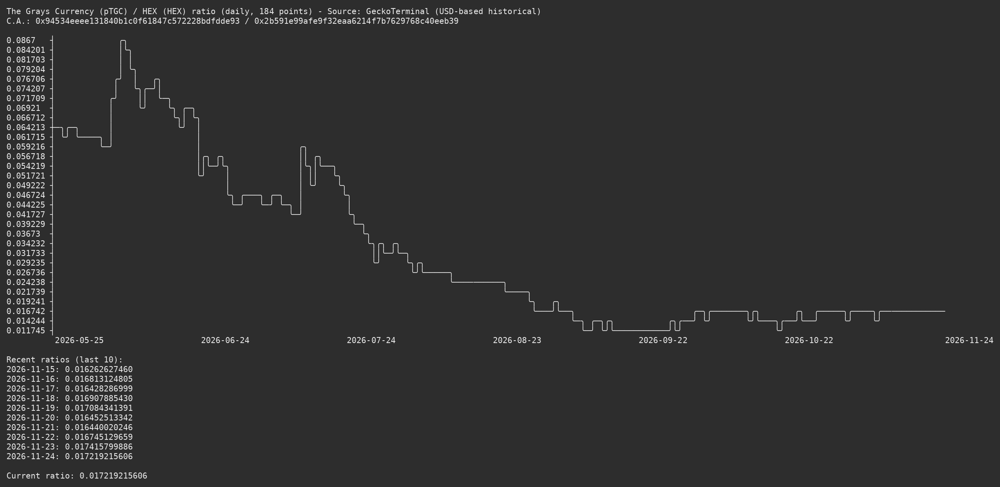

# PulseChain Analytics


[](https://github.com/nottoseethesun/pulsechain-analytics/actions/workflows/ci.yml)
[](https://github.com/nottoseethesun/pulsechain-analytics/actions/workflows/ci.yml)
[](https://github.com/nottoseethesun/pulsechain-analytics/actions/workflows/security-audit.yml)

## Overview

Tools that answer questions about PulseChain:

- how much of a token one transaction sent a wallet, in a cell of Google
  Sheets, Google's spreadsheet app, or at a terminal;
- what a wallet held at a past block or date (the balance checker,
  `check-token-balance/`);
- how two tokens' prices compare over time, charted in the terminal (the
  ratio chart, `chart-price-ratio/`);
- what of a wallet's moves over a range of days Summ, the crypto tax
  calculator the repo's owner, nottoseethesun on GitHub, keeps his books
  in, lacks or holds wrongly (the Summ sweep, `summ-sweep/`), reading what
  the wallet moved from the chain alone (`wallet-history/`, the sweep's
  module, which has no command of its own).

The ratio chart is the one tool that decides on prices:
[`docs/price-determination-rules.md`](docs/price-determination-rules.md)
says which prices it charts, where it reads them, and when it charts
none.

The tools run on Node, the program that runs JavaScript outside a
browser. The first also comes as a script for Google Sheets, written in
Apps Script, Google's platform for scripts that run inside its apps, so
that a sheet's cell can call it. Apps Script cannot import npm packages,
such as ethers, a library for talking to Ethereum-style chains such as
PulseChain. So the script does by hand what the module at the repo's top
folder, `fetch-amount-of-token-transferred.js`, does with ethers: it asks
the chain's rpc endpoint in json-rpc, the protocol such an endpoint
answers, through `UrlFetchApp`, Apps Script's service for web requests.
The module has no command; other Node code imports it, and running it
does nothing.

### The Scripts

The programs you run at a terminal are in `bin/end-user/`; the Sheets
scripts, which a sheet runs, are in
`src/for-google-apps/check-token-balance/`.
Each has a sub-section below; [Run](#run) shows each at work.

#### fetch-amount-of-token-transferred.gs

The Sheets script: a sheet's cell calls its `getTokenTransferred` for how
much of a token one PulseChain transaction sent a wallet. A sheet adds the
owner's deployed copy as a library, or pastes a copy of the file into its
own Apps Script project ([Google Sheets](#google-sheets)).

#### wrapper.gs

The script a sheet pastes into its own Apps Script project when it adds
the library: a cell can call only the functions of the sheet's own
project, so the wrapper gives the project a function for each library
function a cell calls.

#### fetch-amount-of-token-transferred.js

The Sheets script's Node version: it runs
`fetch-amount-of-token-transferred.gs` itself, unchanged, through the
runner of crypto-price-fetchers, the owner's repo of code his projects
share, which [Install](#install) brings, and prints what the script's cell would
show. It is not the module of the same name at the repo's top folder,
which works out the same amount with ethers and has no command.

#### check-token-balance.js

The balance checker: a wallet's balance of each token named, at a block
or at the start of a day in UTC. Its code and packages are in
`check-token-balance/`, which this start file loads.

#### pulse-token-ratio.js

The ratio chart: the ratio of two tokens' prices over time, charted in
the terminal. Its code and packages are in `chart-price-ratio/`, which
this start file loads.

#### summ-sweep.js

The Summ sweep: what of a wallet's moves over a range of days Summ lacks
or holds wrongly. Its code is in `summ-sweep/`, which reads the wallet's
moves through `wallet-history/`.

#### manage-api-keys.js

The key manager, crypto-price-fetchers' too: it lists the api keys the top
`config.json` names, numbered in the services' order of priority, saved or
not, never showing a key's characters, saves each key typed, encrypted
with your password, and asks for that order while none is saved.

## Table of Contents

- [Overview](#overview)
  - [The Scripts](#the-scripts)
    - [fetch-amount-of-token-transferred.gs](#fetch-amount-of-token-transferredgs)
    - [wrapper.gs](#wrappergs)
    - [fetch-amount-of-token-transferred.js](#fetch-amount-of-token-transferredjs)
    - [check-token-balance.js](#check-token-balancejs)
    - [pulse-token-ratio.js](#pulse-token-ratiojs)
    - [summ-sweep.js](#summ-sweepjs)
    - [manage-api-keys.js](#manage-api-keysjs)
- [Disclaimer](#disclaimer)
- [Screenshot](#screenshot)
- [Prerequisites](#prerequisites)
- [Install](#install)
  - [Node](#node)
  - [Google Sheets](#google-sheets)
    - [Adding the Library](#adding-the-library)
    - [Pasting a Script In](#pasting-a-script-in)
  - [Api Keys](#api-keys)
- [Optional: Verify Download](#optional-verify-download)
- [Update](#update)
  - [Versions of crypto-price-fetchers](#versions-of-crypto-price-fetchers)
- [Uninstall](#uninstall)
- [Run](#run)
  - [fetch-amount-of-token-transferred.gs](#fetch-amount-of-token-transferredgs-1)
    - [Usage of fetch-amount-of-token-transferred.gs](#usage-of-fetch-amount-of-token-transferredgs)
  - [wrapper.gs](#wrappergs-1)
    - [Usage of wrapper.gs](#usage-of-wrappergs)
  - [fetch-amount-of-token-transferred.js](#fetch-amount-of-token-transferredjs-1)
    - [Usage of fetch-amount-of-token-transferred.js](#usage-of-fetch-amount-of-token-transferredjs)
  - [check-token-balance.js](#check-token-balancejs-1)
    - [Usage of check-token-balance.js](#usage-of-check-token-balancejs)
  - [pulse-token-ratio.js](#pulse-token-ratiojs-1)
    - [Usage of pulse-token-ratio.js](#usage-of-pulse-token-ratiojs)
  - [summ-sweep.js](#summ-sweepjs-1)
    - [Usage of summ-sweep.js](#usage-of-summ-sweepjs)
  - [manage-api-keys.js](#manage-api-keysjs-1)
    - [Usage of manage-api-keys.js](#usage-of-manage-api-keysjs)
- [Configure](#configure)
- [Lint & Test](#lint--test)
  - [Optional: the Ratio Chart's Questions at a Terminal, by Hand](#optional-the-ratio-charts-questions-at-a-terminal-by-hand)
- [Private Key Security](#private-key-security)
- [Development](#development)
  - [Node Versions of the Sheets Scripts](#node-versions-of-the-sheets-scripts)
  - [Architecture and Engineering References](#architecture-and-engineering-references)
- [License](#license)
- [Road Map](#road-map)
- [Donations](#donations)
- [Contributing](#contributing)

---

## Disclaimer

USE AT YOUR OWN RISK: this software is provided "as is", without warranty
of any kind, as its [license](LICENSE) says. It has not been formally
audited and may contain bugs. Its answers come from a PulseChain rpc
endpoint and from outside price services, which can be wrong, late or
missing: check an answer before you rely on it, for your taxes or for
anything else.

---

## Screenshot

The ratio chart, charting the daily ratio of $pTGC's price to $HEX's on
PulseChain in the terminal, from GeckoTerminal's candles, as this
command, run from the repo's top folder on 24 November 2026 (UTC),
printed it:

```bash
node bin/end-user/pulse-token-ratio.js 0x94534EeEe131840b1c0F61847c572228bdfDDE93 0x2b591e99afE9f32eAA6214f7B7629768c40Eeb39 --source geckoterminal
```

The picture leaves out the lines printed before the chart's title, which
name the pools it picked.



---

## Prerequisites

- A terminal, in which the tools and npm run.
- Node 24 or later, from [nodejs.org](https://nodejs.org/), with npm, the
  package manager that comes with it, which installs a project's packages
  and runs the commands its `package.json` names. The repo is tested on
  Node 24 and 26.
- git, the version-control program, to clone the repo from GitHub, the
  website that hosts it.
- For the amount a transaction sent in a cell: a Google account and a
  spreadsheet in Google Sheets. Apps Script itself has no versions to
  choose from: every script runs on the current one. When a script stops
  working, [Google's release notes](https://developers.google.com/apps-script/release-notes)
  may say what changed.
- For a balance at a past block: an rpc endpoint that keeps past state,
  such as the default, g4mm4's, a PulseChain node operator's public
  endpoint.
- For the Summ sweep: an rpc endpoint that keeps past state and offers
  the debug methods `debug_traceTransaction` and `debug_traceBlockByNumber`,
  as g4mm4's does; a checkout of LP Ranger, the owner's bot that manages
  his 9mm V3 liquidity positions, whose bookkeeping tool the sweep runs;
  and a copy of Summ's csv template.
- Optional: the api keys of the ratio chart ([Api Keys](#api-keys)).

---

## Install

The tools run on two platforms, Node and Google Apps Script, and each
installs its own way. The api keys, each optional, are for the ratio
chart.

### Node

Clone the repo, then, from its top folder, install the top folder's
packages, then those of the two tools that have a package of their own.
npm installs the packages each folder's `package.json` lists, at the
versions its `package-lock.json` keeps:

```bash
git clone https://github.com/nottoseethesun/pulsechain-analytics.git
cd pulsechain-analytics
npm ci
npm ci --prefix chart-price-ratio
npm ci --prefix check-token-balance
```

Each installs crypto-price-fetchers from GitHub: it runs the Sheets
script under Node, keeps the api keys, writes the Summ sweep's csv, and
asks, for the ratio chart, GeckoTerminal, a service that lists the pools
of decentralized exchanges with their prices and candles, and Moralis
and DexTools, two services that price tokens from those pools.

### Google Sheets

A sheet can run the Sheets script, `fetch-amount-of-token-transferred.gs`
in `src/for-google-apps/check-token-balance/`, two ways: as a library, the
owner's deployed copy, which he updates and which keeps each answer in a
cache, or as a copy pasted into the sheet's own project, which does not
change when the repo does and keeps no cache. A sheet with a pasted copy
needs no wrapper: its cells call the copy's `getTokenTransferred`.

#### Adding the Library

A sheet's project adds the library by the script's ID, which the
[README beside the script](src/for-google-apps/check-token-balance/README.md)
gives: the part of the library's URL after `/d/`, before the version
number. That README gives the full deployment info too, such as:

```terminal
Version 5 on Nov 21, 2025, 4:07 PM
Deployment ID: AKfycbyBWersgxf4_JBg40CT-h9iAwfcfC3Rj4T_3aoVtfTj1EpjLQtqH6Ac3xG7CjyGZ4c
Library URL:  https://script.google.com/macros/library/d/1HFXEAhRh3-fSqNLzi9i-oMDLwr2aV4zp8-NNxv6moDfRDVGDgHn7BtqG/5
```

1. Copy the script's ID from the README beside the script.
2. In the sheet, choose **Extensions → Apps Script**.
3. On the left, click **+** beside **Libraries**, and paste the ID into
   **Script ID**.
4. Click **Look up**, choose the latest version (the highest number),
   keep the identifier `FetchTokenAmountTransferredSA`, which `wrapper.gs`
   calls, and click **Add**.

A cell cannot call a library's functions directly, only those of the
sheet's own Apps Script project. So the project also needs a wrapper: a
function of its own for each library function, which calls the library.
Paste the tool's `wrapper.gs` into the sheet's project, as
[Pasting a Script In](#pasting-a-script-in) describes, and call the
wrapper's functions from cells. You can add wrappers of your own.

#### Pasting a Script In

A script, such as `wrapper.gs`, or the Sheets script itself in place of
the library, is pasted into the sheet's own project:

1. On GitHub, open the file, and copy it with the **Copy raw file**
   button.
2. In the sheet, choose **Extensions → Apps Script**.
3. Open the project's file `Code.gs`, or make a new one: click **+**
   beside **Files**, choose **Script**, and type its name, to which Apps
   Script adds `.gs`.
4. Select all of the file's code (Ctrl+A, or Cmd+A on a Mac), paste over
   it (Ctrl+V, or Cmd+V), and save (Ctrl+S, or Cmd+S).

### Api Keys

The ratio chart sends two api keys: Moralis's, to read two years of daily
candles from Moralis, and DexTools', to fall back to current prices when
the candles cannot be had. The keys are kept in
`api-keys.json` in the repo's top folder, which git ignores, encrypted
with a password you choose, by crypto-price-fetchers' key store, which
keeps keys as LP Ranger keeps its own. This repo's `npm run api-keys` runs
the store's key manager. To save the keys, from the repo's top folder:

```bash
npm run api-keys
```

It lists each key the top `config.json` names, numbered in the services'
order of priority, saved or not, never showing its characters, and asks
for each one not saved: the key, then the password, showing nothing of
what is typed. The password is typed twice while no key is saved, and
once after that. A program that opens the keys, the key manager among
them, takes the password from the environment variable
`API_KEYS_PASSWORD` when it holds one, and asks for it only when it does
not; [`docs/engineering.md`](docs/engineering.md) says how a terminal can
keep it there. Each key is saved only once its service takes it.

Then, while no order of priority is saved for the two services, it asks
for one, showing what is typed, since the order is no secret: their
numbers, highest priority first, such as `2 1` to put Moralis first.
Enter alone keeps the order shown, which until an order is saved is the
one `config.json` lists them in, DexTools then Moralis. The order is saved
in `api-keys.json`, and `npm run api-keys -- rank` changes it. Where two
services with keys can do one job, the programs ask them in that order;
DexTools and Moralis do different jobs, so the order changes nothing the
ratio chart does
([section 6 of How the Ratio Chart Decides Its Prices](docs/price-determination-rules.md#6-when-the-candles-cannot-be-had-dextools)
says why).

---

## Optional: Verify Download

Shows that your clone is at the commit GitHub has, and that the packages
npm installed are the ones the lockfiles name.

git names each commit by a hash of its files and its history, so a
commit's name changes when any of its files does, and two clones at
commits of the same name hold the same files. From the repo's top folder,
these print the commit you have and the commit GitHub has for `main`; the
same 40 characters in both mean you hold the code GitHub holds:

```bash
git rev-parse HEAD
git ls-remote https://github.com/nottoseethesun/pulsechain-analytics.git main
```

`npm ci` checks every package it downloads from npm's registry against
the hash `package-lock.json` keeps for it, its `integrity`, and stops when
one differs. crypto-price-fetchers comes from GitHub instead, at the
commit each lockfile names. actionlint, the checker of GitHub Actions
workflow files that the lint runs, is downloaded by crypto-price-fetchers'
bin `run-actionlint`, which refuses it unless its SHA-256 is the one that
repo pins.

---

## Update

From the repo's top folder, take the newest commit of `main`, then install
the packages its lockfiles name:

```bash
git pull
npm ci
npm ci --prefix chart-price-ratio
npm ci --prefix check-token-balance
```

The api keys, in `api-keys.json`, and your settings in the files git
ignores stay as they are. Three settings files are files git keeps: the
top `config.json`, `chart-price-ratio/config.json` and
`check-token-balance/config.json`. When you changed one and a newer
commit changes it too, `git pull` stops rather than write over your
change, and `git stash`, then `git pull`, then `git stash pop` carries
your change across. A sheet that added the library runs the version it
chose: to take a newer one, choose it under **Libraries** in the
sheet's Apps Script project. A pasted copy changes only when it is pasted
again.

### Versions of crypto-price-fetchers

The top folder, `chart-price-ratio/` and `check-token-balance/` install
crypto-price-fetchers straight from its GitHub project, rather than from
npm's registry, at the commit each lockfile names, so this step is
optional. Each `package.json` names it with a ref: `#main`, its
main branch, which this repo follows, or `#semver:*`, its latest release,
its highest version tag. Each `package-lock.json` keeps the commit the ref
named when the lockfile was made, and `npm ci` installs that commit.

crypto-price-fetchers also holds the tool that moves all three: its
versions tool, which this repo runs as `npm run github-project-deps`. It
sets the ref in the three `package.json` files, then makes each folder's
`package-lock.json` again from a fresh `node_modules`, so the newest
commit, or the newest release, is installed. If an install fails, every
`package.json` and `package-lock.json` goes back as it was, and
`node_modules` is installed again from them. From the repo's top folder,
the newest commit of main:

```bash
npm run github-project-deps -- main
```

The latest release:

```bash
npm run github-project-deps -- release
```

No release can be installed yet: every release of crypto-price-fetchers,
the newest being 1.3.0, came before its `package.json`, so `release`
fails, and the files go back as they were. It works once a release with a
`package.json` is tagged.

---

## Uninstall

1. In each sheet that uses the Sheets script, open **Extensions → Apps
   Script**: remove the library under **Libraries**, and delete the
   wrapper, or the pasted copy of the script.
2. In each terminal where `API_KEYS_PASSWORD` holds the password, run
   `unset API_KEYS_PASSWORD`, or close the terminal.
3. From the folder that holds it, delete the repo's folder, which holds
   `api-keys.json`:

   ```bash
   rm -rf pulsechain-analytics
   ```

   To retire the keys themselves, revoke them at Moralis and DexTools.

---

## Run

The programs you run at a terminal are in `bin/end-user/`, each run
from the repo's top folder, with `node` or through npm;
the Sheets scripts are in `src/for-google-apps/check-token-balance/`, and
a sheet runs them once they are added to it
([Google Sheets](#google-sheets)). Each sub-section below covers one:
first an example of how to run it, then what it does, and, under its
Usage, more examples, of the options and cases that take more. Each command line answers `--help` with its options, more
examples and its exit codes, and
[`docs/project-commands.md`](docs/project-commands.md) lists every
command with its flags. `<wallet>` and `<transaction-hash>` stand for
your own.

### fetch-amount-of-token-transferred.gs

```text
=getTokenTransferred(A2, "0x2b591e99afE9f32eAA6214f7B7629768c40Eeb39", B2)
```

In a cell, this gives the HEX that the transaction in cell A2 sent the
wallet in cell B2. `getTokenTransferred(transaction, token, wallet)` gives how much of a
token one PulseChain transaction sent a wallet: it reads the
transaction's receipt and adds up the token's transfers to the wallet in
it, cut off at 7 decimal places rather than rounded. For an amount of
2^29, 536,870,912 tokens, or more, turning it into a number can round the
7th place. A failed read shows in the cell as an error. With the script
pasted into the sheet's project, a cell calls the copy's
`getTokenTransferred`, which keeps no cache; with the library added, a
cell calls the wrapper's, below, in the same way.

#### Usage of fetch-amount-of-token-transferred.gs

Each row's own token, its contract address in column C, so that one
formula, filled down the column, reads transfers of several tokens:

```text
=getTokenTransferred(A2, C2, B2)
```

The wrapped PLS that one transaction sent one wallet, both typed into the
formula:

```text
=getTokenTransferred("<transaction-hash>", "0xA1077a294dDE1B09bB078844df40758a5D0f9a27", "<wallet>")
```

### wrapper.gs

```text
=getTokenTransferred(A2, "0x2b591e99afE9f32eAA6214f7B7629768c40Eeb39", B2)
```

With the library and the wrapper in the sheet's project, this gives the
same amount as above. The wrapper's
`getTokenTransferred` asks the library's caching function, which answers
a repeated call from its cache, since a transaction's amount does not
change once it is on the chain, and its `getTokenTransferredNoCache`
asks without the cache. A sheet with a pasted copy of the script has no
`getTokenTransferredNoCache`.

#### Usage of wrapper.gs

The same amount as above, asked of the chain each time, without the
cache:

```text
=getTokenTransferredNoCache(A2, "0x2b591e99afE9f32eAA6214f7B7629768c40Eeb39", B2)
```

Each row's own token, its contract address in column C, from the cache:

```text
=getTokenTransferred(A2, C2, B2)
```

### fetch-amount-of-token-transferred.js

```bash
node bin/end-user/fetch-amount-of-token-transferred.js <transaction-hash> 0x2b591e99afE9f32eAA6214f7B7629768c40Eeb39 <wallet>
```

This prints how much HEX one transaction sent a wallet.
`bin/end-user/fetch-amount-of-token-transferred.js` runs the Sheets script under
Node, unchanged, and prints what its cell would show, with exit code 0,
or the script's message on stderr, with exit code 1. It asks the rpc
endpoint the optional `config.json` beside the Sheets script names, or
else the one the script is written with, g4mm4's
([Configure](#configure)).

#### Usage of fetch-amount-of-token-transferred.js

The same, with the script's log on stderr, which shows each step it took:

```bash
node bin/end-user/fetch-amount-of-token-transferred.js --verbose <transaction-hash> 0x2b591e99afE9f32eAA6214f7B7629768c40Eeb39 <wallet>
```

The same, from the rpc endpoint that a settings file of yours names, in
the shape of `config-example.json` beside the Sheets script:

```bash
node bin/end-user/fetch-amount-of-token-transferred.js --config ~/pulsechain-endpoint.json <transaction-hash> 0x2b591e99afE9f32eAA6214f7B7629768c40Eeb39 <wallet>
```

### check-token-balance.js

```bash
node bin/end-user/check-token-balance.js --address <wallet> --date 2026-11-01 --tokens Pulse_Native_Gas_Token,0x2b591e99afE9f32eAA6214f7B7629768c40Eeb39
```

This prints a wallet's PLS and HEX at the start of 1 November 2026, UTC.
`bin/end-user/check-token-balance.js`, the balance checker, prints a wallet's
balance of each token named, at a block or at the start of a day in UTC.
A token is named by its contract address; PLS, the chain's own coin, has
no contract, so it is named `Pulse_Native_Gas_Token`. It reads its
settings from the `config.json` in `check-token-balance/`, whichever
folder it runs in.

#### Usage of check-token-balance.js

The same wallet's PLS at one block, from another rpc endpoint that keeps
past state:

```bash
node bin/end-user/check-token-balance.js --address <wallet> --block 22000000 --tokens Pulse_Native_Gas_Token --rpc https://rpc.pulsechain.com
```

The same wallet's wrapped PLS and HEX at the start of 2026, from a node
on this computer that keeps past state:

```bash
node bin/end-user/check-token-balance.js --address <wallet> --date 2026-01-01 --tokens 0xA1077a294dDE1B09bB078844df40758a5D0f9a27,0x2b591e99afE9f32eAA6214f7B7629768c40Eeb39 --rpc http://localhost:8545
```

### pulse-token-ratio.js

```bash
node bin/end-user/pulse-token-ratio.js 0x2b591e99afE9f32eAA6214f7B7629768c40Eeb39 0xA1077a294dDE1B09bB078844df40758a5D0f9a27
```

This charts the ratio of HEX's price to wrapped PLS's, day by day.
`bin/end-user/pulse-token-ratio.js`, the ratio chart, charts the ratio of two
PulseChain tokens' prices (token A / token B) in the terminal, even when
no pool trades one for the other: it prices each token in USD, from a
pool of its own. It reads the candles of GeckoTerminal, which takes no
key, or of Moralis, which takes one. With a Moralis key saved, it asks
which to read, Enter taking Moralis, unless `--source` names one. When
the candles cannot be had, as when the source cannot list a token's pools
or pairs, or gives no candles of them, it falls back to each token's
current price from DexTools, one point, with a DexTools key saved. With
no DexTools key saved, or when DexTools gives no price, the run stops
with exit code 1. It reads its settings from the
`config.json` in `chart-price-ratio/`, whichever folder it runs in.
[Its README](chart-price-ratio/README.md) covers how it picks each pool.
`npm start -- <options>`, in `chart-price-ratio/`, runs the same command
line.

#### Usage of pulse-token-ratio.js

The same ratio hour by hour, also written to a CSV file,
`chart-price-ratio/output/csv/token_ratio.csv`, where git keeps nothing
but the folder:

```bash
node bin/end-user/pulse-token-ratio.js 0x2b591e99afE9f32eAA6214f7B7629768c40Eeb39 0xA1077a294dDE1B09bB078844df40758a5D0f9a27 hourly --csv
```

The daily ratio over the last two years, from Moralis, without the
question of the source:

```bash
node bin/end-user/pulse-token-ratio.js 0x2b591e99afE9f32eAA6214f7B7629768c40Eeb39 0xA1077a294dDE1B09bB078844df40758a5D0f9a27 --source moralis
```

### summ-sweep.js

```bash
npm run summ-sweep -- --wallet <wallet> --start-date 2026-10-01 --end-date 2026-10-31 --summ-synced-to "2026-10-31 23:59:59" --summ-results summ-sweep/input/summ-results-1.json summ-sweep/input/summ-results-2.json --out summ-sweep/output/csv/missing.csv --report summ-sweep/output/json/report.json
```

This sweeps a wallet's October 2026 against two saved pages of Summ's
results. `bin/end-user/summ-sweep.js`, the Summ sweep, which `npm run summ-sweep` runs,
compares a wallet's history on PulseChain, read from the chain alone,
with its records in Summ, and writes a csv of rows for what Summ lacks
and a report, as json, of what to fix. It reads its settings from the
folder it runs in, the repo's top folder. It needs three things:

- the owner's settings in `summ-sweep/config.json`
  ([Configure](#configure));
- Summ's rows of the wallet, saved to files a page at a time from Summ's
  connector for Claude, Anthropic's AI assistant, which reaches Summ
  through it, in `summ-sweep/input/`;
- the time up to which Summ's sync has read the wallet's transactions,
  which `--summ-synced-to` takes, since Summ's connector gives an
  account's last sync as a date alone.

It writes the csv in `summ-sweep/output/csv/` and the report in
`summ-sweep/output/json/`, as the examples name them. The files hold your
own data, and the repo is public, so git keeps nothing in those folders
but the folders.

#### Usage of summ-sweep.js

The same sweep run again after fixing a leg in Summ and saving Summ's
results again, writing over the last run's files:

```bash
npm run summ-sweep -- --wallet <wallet> --start-date 2026-10-01 --end-date 2026-10-31 --summ-synced-to "2026-10-31 23:59:59" --summ-results summ-sweep/input/summ-results-1.json summ-sweep/input/summ-results-2.json --out summ-sweep/output/csv/missing.csv --report summ-sweep/output/json/report.json --replace
```

The first 23 days of November, while Summ's sync has read the wallet's
transactions only up to 18:00 UTC on 22 November: the rows of the
transactions after that time carry no gas, for the sync to bring:

```bash
npm run summ-sweep -- --wallet <wallet> --start-date 2026-11-01 --end-date 2026-11-23 --summ-synced-to "2026-11-22 18:00:00" --summ-results summ-sweep/input/summ-results-1.json --out summ-sweep/output/csv/missing-1-to-23.csv --report summ-sweep/output/json/report-1-to-23.json
```

[The Summ Sweep](docs/architecture.md#the-summ-sweep) explains its rules.

### manage-api-keys.js

```bash
npm run api-keys
```

This lists each key the top `config.json` names, numbered in the
services' order of priority, saved or not, never showing its characters,
with a question for each one not saved, and then, while no order of
priority is saved, a question for one ([Api Keys](#api-keys)):
`bin/end-user/manage-api-keys.js`, which `npm run api-keys` runs, is
crypto-price-fetchers' key manager.

#### Usage of manage-api-keys.js

DexTools' saved key replaced, as after DexTools issues a new one:

```bash
npm run api-keys -- set dextools
```

The services' order of priority shown, numbered, and a new one saved,
typed as their numbers, highest priority first, such as `2 1`:

```bash
npm run api-keys -- rank
```

Whether the password in `API_KEYS_PASSWORD` opens every saved key, by
its exit code, 0 when it does; run with no `API_KEYS_PASSWORD` set, it
says so and ends with exit code 1:

```bash
npm run api-keys -- check-password
```

---

## Configure

The tools run as they come, but for the Summ sweep, which needs the
owner's settings in `summ-sweep/config.json`, with the paths of his Summ
csv template and his LP Ranger checkout set. A settings file changes how
a tool runs. Each file is JSON, checked against its JSON Schema, a description of the keys
the file may hold and the kind of value each takes, before the tool takes
any setting: a key the tool does not read, or a value of the wrong kind,
stops the run, with every problem listed, one line each.

| File | Read by | Holds |
| ---- | ------- | ----- |
| `config.json`, at the repo's top | the key store and the Summ sweep | `apiKeys`, the services whose keys the project keeps, and `pulsechain`, the chain's facts the sweep reads: its id, its rpc endpoint, the position manager of 9mm V3, the wrapped coin, the widest log search in blocks, the spacing of requests and the most asked in one batch |
| `chart-price-ratio/config.json` | the ratio chart | the default of each of its options; `csvFilename`, the CSV `--csv` writes, is a path read from `chart-price-ratio/` |
| `check-token-balance/config.json` | the balance checker | `defaultRpc`, the rpc endpoint it asks unless `--rpc` names another |
| `src/for-google-apps/check-token-balance/config.json`, optional, which git ignores | `bin/end-user/fetch-amount-of-token-transferred.js`, the Sheets script's Node version | `config.rpcUrl`, the rpc endpoint it asks, in place of g4mm4's, which the script is written with; `config-example.json` beside it shows the shape |
| `summ-sweep/config.json`, which git ignores | the Summ sweep | the path of the Summ csv template, the path of an LP Ranger checkout, whose bookkeeping tool reads each withdrawal from a position, the owner's other wallets with their names, the tokens to book as spam and as income, and the symbols Summ and a csv give each token whose symbol differs from its contract's; `config-example.json` beside it shows the shape |

Beside each `config.json` is a `config-example.json`, which git keeps,
holding its settings with their default values, or, for your own
settings, made-up ones that show the shape: copy it to `config.json`,
beside it, and change what you need.
[Settings Files](docs/architecture.md#settings-files) explains the
schemas.

---

## Lint & Test

The gate, LP Ranger's, runs the lint, the tests and the security audits,
and must pass before every commit and push. The lint runs ESLint, which
checks JavaScript against rules; markdownlint, which checks the form of
Markdown files; the check of Prettier, a program that formats code;
actionlint; and knip, which finds files nothing uses. From the repo's top
folder, after the installs of [Node](#node):

```bash
npm run lint      # the linters above
npm test          # the tests, on Node's test runner
npm run check     # the whole gate, as CI runs it
```

The tests ask no outside service: the tools run against stand-ins on the
computer. The Sheets script also holds test functions that run only in
Apps Script, by hand; [`docs/engineering.md`](docs/engineering.md) sets
the two kinds apart.

### Optional: the Ratio Chart's Questions at a Terminal, by Hand

At a terminal, the ratio chart asks which source to read when a Moralis
key is saved and no `--source` names one, and the key store then asks
for the password of the keys. A terminal shows each key typed unless the
program reading it turns the terminal's raw mode on, which both prompts
do. The tests run on Node alone, so they answer the questions at a
stand-in terminal (`test/helpers/stand-in-terminal-preload.js`), which
checks that each prompt turns raw mode on and then off, but not what a
real terminal shows. To see that, with a Moralis key saved by
`npm run api-keys`, in a terminal where `API_KEYS_PASSWORD` is not set,
from the repo's top folder:

1. Run
   `node bin/end-user/pulse-token-ratio.js 0x94534EeEe131840b1c0F61847c572228bdfDDE93 0x2b591e99afE9f32eAA6214f7B7629768c40Eeb39`.
   It lists the two sources and asks "Which should this run read, 1 or
   2?".
2. Press Enter, which takes Moralis. It asks for the password of the api
   keys; type it: the terminal shows nothing typed, and the chart is
   drawn from Moralis's candles.
3. Run the same command again, and answer 2. It asks for no password,
   and the chart is drawn from GeckoTerminal's candles.

---

## Private Key Security

No tool here holds a wallet's private key or seed phrase: the tools read
the chain and price services, and write files.

The api keys are kept in `api-keys.json`, which git ignores, each
encrypted by AES-256-GCM with a key made from your password by
PBKDF2-SHA512 at 600,000 rounds, as LP Ranger keeps its keys. The password
is kept nowhere on disk, and each tool holds the keys only in memory, for
one run. No
tool prints a key's characters, and a key is never a setting in a file nor
a command-line argument.

**A lost password cannot be recovered**, and the keys saved with it cannot
be opened: delete `api-keys.json` and save each key again with
`npm run api-keys`, under a new password.

---

## Development

The repo follows the coding standards of LP Ranger: its `CLAUDE.md` and
everything under its `docs/claude/`.

### Node Versions of the Sheets Scripts

A Google Apps Script here can have a Node version in `bin/end-user/`, of the same
name ending in `.js`, which runs the same `.gs` file under Node, unchanged,
through crypto-price-fetchers' runner, so the two give the same answers.
`src/for-google-apps/check-token-balance/fetch-amount-of-token-transferred.gs`
has one, `bin/end-user/fetch-amount-of-token-transferred.js`; the
[README beside the script](src/for-google-apps/check-token-balance/README.md)
says how a Node program uses it.

### Architecture and Engineering References

The `docs/` folder holds four references:

- [`docs/architecture.md`](docs/architecture.md): how the tools work.
- [`docs/price-determination-rules.md`](docs/price-determination-rules.md):
  how the ratio chart decides its prices.
- [`docs/engineering.md`](docs/engineering.md): the files, the gates, the
  tests and CI: the checks GitHub runs, through its GitHub Actions
  service, on each pull request and each push to `main`.
- [`docs/project-commands.md`](docs/project-commands.md): every command,
  with its flags and an example.

---

## License

Licensed under the MIT License. See [LICENSE](LICENSE) for the full text.

---

## Road Map

The repo lists no planned work yet, and no bug is known.

---

## Donations

The owner takes donations for his projects at the address in
[LP Ranger's Donations](https://github.com/nottoseethesun/lp-ranger#donations).

---

## Contributing

Fork me on GitHub. Contributions are welcome, and any contribution is
subject to the license in the [LICENSE](LICENSE) file. Bug reports and
ideas go in the
[Issues](https://github.com/nottoseethesun/pulsechain-analytics/issues)
tab. A change must pass `npm run check` ([Lint & Test](#lint--test)).
