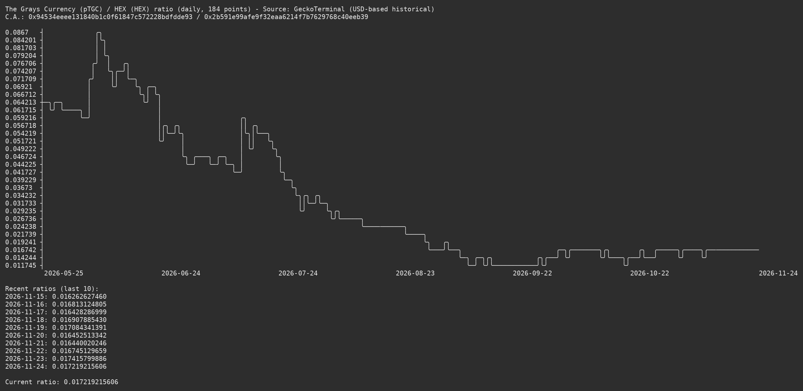

# PulseChain Token Ratio Chart

A tool, on Node, the program that runs JavaScript outside a browser, that
charts the ratio of two PulseChain tokens' prices (token A / token B) in
the terminal, even when no pool trades one for the other. It
prices each token in USD, from a pool of its own, whichever side of the
pool the token is on, so the ratio of the two prices needs no pool between
them.

A run reads its prices from the candles of one of two sources, and from
that one alone:

- **GeckoTerminal**, a service that lists the pools of decentralized
  exchanges with their prices and candles, and needs no api key. Its free
  api serves about the last 184 days of candles.
- **Moralis**, a service that prices tokens from the same pools, with a
  Moralis api key: the last two years of daily candles, unless
  `--moralis-days` names another span.

With no Moralis key saved, a run reads GeckoTerminal's candles. With one
saved, it asks which to read, Enter taking Moralis, unless `--source`
names one. The chart asks both through the clients of
crypto-price-fetchers, the owner's repo of code his projects share. When
the candles cannot be had, as when the source cannot list a token's pools
or pairs, or gives no candles of them, the chart falls back to each
token's current price from **DexTools**, a third such service, which
takes an api key: one point. It cannot fall back with no DexTools key
saved, or when DexTools does not answer in time, answers with an error,
or gives no price for a token: the run then stops with exit code 1, and
prints no ratio.

IMPORTANT: Use at your own risk as defined in the included file, `../LICENSE`.

## Features

What the chart does, in brief. The file header of `pulse-token-ratio.js`
gives the details.

- **Pool choice:** from GeckoTerminal, for each token, it takes the most
  liquid of its five most liquid pools. A new pool can be the most liquid,
  with little history, so if that pool's history is less than half the
  longest among the five, it takes the pool with the longest history
  instead, provided that pool has at least a tenth of the top pool's
  liquidity. From Moralis, it takes the deepest active pair that lists the
  token first, since Moralis's candles of a pair price the token the pair
  lists first, as in HEX / WPLS, which prices HEX.
- **Names:** it shows each token's name, symbol and contract address.
- **Y-axis:** it spans the lowest ratio to the highest, with no two labels
  the same.
- **X-axis:** dates, or dates with the hour, each under the column it
  labels.
- **Intervals:** hourly, daily, the default, or weekly. GeckoTerminal's
  184 days of candles make 184 daily points but at most 27 weekly ones;
  Moralis's two years make about 730 daily points and 105 weekly ones.
- **Pairing:** each ratio divides the two tokens' prices of the same time,
  at the times both pools have a candle for, since GeckoTerminal makes no
  candle for a period in which nothing traded.
- **CSV:** it writes the ratios to a CSV file when asked.
- **DexTools fallback:** it needs a saved DexTools key. Without one, the
  chart says so, and charts from its source of candles alone.

## Pre-requisites

Node 24 or later, from nodejs.org or a version manager (a Linux
distribution's own `nodejs` package can be older).

## Installation

git, the version-control program, copies the repo from GitHub, the website
that hosts it, and npm, Node's package manager, installs the tool's
packages:

```bash
git clone https://github.com/nottoseethesun/pulsechain-analytics.git
cd pulsechain-analytics/chart-price-ratio
npm ci
```

`npm ci` installs what the chart needs, at the versions
`package-lock.json` keeps, crypto-price-fetchers among
it, for its key store and its GeckoTerminal, Moralis and DexTools clients. Which version of
crypto-price-fetchers is installed, and how to change it, is in the repo's
[README](../README.md#versions-of-crypto-price-fetchers).

## Configuration

Edit `config.json` to set defaults; `config-example.json`, beside it,
holds the same settings with their defaults:

```json
{
  "network": "pulsechain",
  "chain": "pulse",
  "dextools": {
    "subscription": "standard",
    "host": "https://public-api.dextools.io",
    "version": "v2"
  },
  "moralis": {
    "chain": "0x171",
    "days": 730
  },
  "csvFilename": "output/csv/token_ratio.csv",
  "interval": "daily",
  "maxCandles": 1000,
  "weeklyResampleDays": 7,
  "useDexToolsOnly": false
}
```

`moralis.chain` is Moralis's id for PulseChain, and `moralis.days` the
days of daily candles a run reads from Moralis. `csvFilename` is a path
read from this folder, so a run writes the CSV in `output/csv/` here
wherever it runs; git keeps nothing in that folder but the folder. A
path `--csv-filename` takes is read from the folder the chart runs in.

The file is checked against its JSON Schema, `RATIO_SETTINGS_SCHEMA` in
`ratio-command.js`, before any setting is taken: a key the schema does not
name, such as a misspelled one, or a value of the wrong kind, such as a
`maxCandles` of 0, stops the run, with every problem listed. A typed option
meets the rule its setting meets here, and `--source` is refused beside a
`useDexToolsOnly` set to true here.

### API keys

A Moralis API key lets a run read two years of daily candles from Moralis,
and a DexTools API key enables the current-price fallback when the candles
cannot be had. A key is no setting and no command-line argument: save it
encrypted, with a password you choose, in the repo's top folder, whose
`npm run api-keys` runs crypto-price-fetchers' key manager:

```bash
cd ..
npm ci
npm run api-keys
```

The chart opens each key the first time it asks that service, with the
password, which it asks for. A run that reads
GeckoTerminal's candles and never falls back asks for no password. See the
repo's [README](../README.md#api-keys).

## Run

```bash
node bin/end-user/pulse-token-ratio.js <tokenA> <tokenB>
```

Run from the repo's top folder, this charts the daily ratio of two
tokens, the default. The chart runs through its start file,
`bin/end-user/pulse-token-ratio.js`, in the repo's `bin/end-user/`, the
folder of the programs only an end user runs, after `npm ci` here. It reads the `config.json`
here whichever folder it runs in. `npm start -- <options>`, here, runs
the same command line. `node bin/end-user/pulse-token-ratio.js --help` lists every
option, each with its default from `config.json`, examples of its common
uses, and the exit codes: 0 when the ratios were printed, 1 when they
were not.

### Usage of pulse-token-ratio.js

The chart spans at least 90 columns, so its x-axis has room to space its
dates. A series of fewer points is drawn with each point widened over
several columns, the points joined by straight lines. A weekly run from
GeckoTerminal says first that GeckoTerminal's free api serves about the
last 184 days, so its chart shows at most 27 points.

#### Example with $808 and $pTGC

`node bin/end-user/pulse-token-ratio.js 0x50F1ca62e6Fb8Adf438ca1F50067AB83670094A6 0x94534EeEe131840b1c0F61847c572228bdfDDE93`

#### Specify Interval

```bash
node bin/end-user/pulse-token-ratio.js <tokenA> <tokenB> --interval=hourly
node bin/end-user/pulse-token-ratio.js <tokenA> <tokenB> --interval=weekly
```

#### Export to CSV

The ratios also written to `output/csv/token_ratio.csv`, in this folder:

`node bin/end-user/pulse-token-ratio.js <tokenA> <tokenB> --interval=daily --csv`

#### Choose the source without the question

```bash
node bin/end-user/pulse-token-ratio.js <tokenA> <tokenB> --source moralis
node bin/end-user/pulse-token-ratio.js <tokenA> <tokenB> --source geckoterminal
```

A run with a Moralis key saved and no terminal to ask at, such as one
whose input is a pipe, stops unless `--source` names one.

## Output Example

The daily ratio of $pTGC to $HEX on PulseChain, from GeckoTerminal's
candles, as this command, run from the repo's top folder on 24 November
2026 (UTC), printed it:

```bash
node bin/end-user/pulse-token-ratio.js 0x94534EeEe131840b1c0F61847c572228bdfDDE93 0x2b591e99afE9f32eAA6214f7B7629768c40Eeb39 --source geckoterminal
```

The picture leaves out the lines printed before the chart's title, which
name the pools it picked.



## Contributing

See the info on Contributing at `../README.md`.
